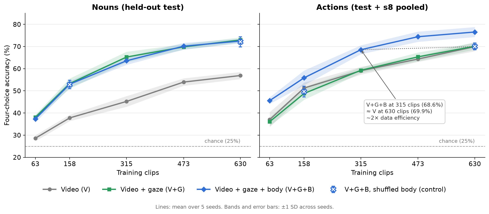

# Nursery

Nursery asks whether video plus bodily experience supports better language
learning than video alone, as independent training experience increases.
The simulator supplies egocentric video and body signals; caregiver speech
provides intentionally uncertain language supervision.

## Phase 1 milestone: noun and action acquisition curves



**Setup.** Three learners see the same simulated child experience and hear the
same weak, noisy caregiver speech (naming is often delayed or about an object
not in hand). They differ only in their inputs:

- **V**: egocentric video, including temporal motion.
- **V+G**: V plus child gaze, which steers attention and adds a sharp close-up
  of where the child looks.
- **V+G+B**: V+G plus body signals: touch, hand pose, arm motion and wrist load.

Each is tested on four-choice word matching (chance 25%), trained on 63–630
clips with 5 seeds each (85 models). Accuracy is the 5-seed mean (%). Body gain
is V+G+B − V+G and gaze gain is V+G − V, in percentage points.

| Clips | Actions V | Actions V+G+B | Body gain | Nouns V | Nouns V+G | Gaze gain |
|---|---|---|---|---|---|---|
| 63 | 37.0 | 45.6 | **+9.5** | 28.6 | 38.1 | **+9.5** |
| 158 | 51.3 | 55.9 | **+7.1** | 37.8 | 53.3 | **+15.5** |
| 315 | 59.1 | 68.6 | **+9.3** | 45.2 | 65.3 | **+20.0** |
| 473 | 64.3 | 74.4 | **+9.1** | 54.0 | 69.8 | **+15.9** |
| 630 | 69.9 | 76.5 | **+6.4** | 56.9 | 72.9 | **+16.0** |

**What it shows: a double dissociation.**

- Gaze lifts nouns at every amount and adds ≈ 0 on actions: it settles
  *which object* a word refers to.
- Body lifts actions at every amount and adds ≈ 0 on nouns: it grounds
  *physical actions*. V+G+B at 315 clips (68.6%) about matches V at 630 (69.9%),
  roughly 2× sample efficiency.
- Shuffled body adds ≈ 0 pp, so the gain comes from body signals aligned with
  the speech, not from extra parameters.
- On object-matched actions, where the object can't give the answer away, body
  still adds +7.8 to +12.4 pp.
- The earlier heavy/light proof of concept gained +46 pp from body
  ([archived Step 7](archive/phase1_embodied/docs/step_7_word_types.md)).
- Video is still climbing at 630 clips, so whether it plateaus is still open.

Full Step 9 protocol:
[archive/phase1_embodied/docs/step_9_acquisition_curves.md](archive/phase1_embodied/docs/step_9_acquisition_curves.md).
Archived data, analysis and plotting script:
[docs/results/noun_action_acquisition_curves/](docs/results/noun_action_acquisition_curves/).

## Phase 2 (active on `research/unified-architecture`): Unified Embodied Learner

Start with [docs/unified/CONTEXT.md](docs/unified/CONTEXT.md) and
[PLAN.md](PLAN.md). Phase 2 replaces Phase 1's per-word temporal weight and
post-hoc body-weight sweep with one clean **Embodied Baby-CoCa** architecture
(`nursery/unified/`):

- **Three aligned 512-d sensory streams** (Static Vision+Gaze, Temporal Video,
  Body) + **zero-init cross-modal MHSA**.
- **Compact 2-layer Causal Text Transformer** trained from scratch +
  utterance-conditioned **Modality Gate `g(T)`** on the 2-simplex + dual
  contrastive & generative heads.
- **Step-by-step blueprints:**
  [U1 Unified learner](docs/unified/step_u1_unified_learner.md) ·
  [U2 Compositional sentences & VP-Swap](docs/unified/step_u2_compositional_sentences.md) ·
  [U3 Fair VLM baselines](docs/unified/step_u3_fair_baselines.md) ·
  [U4 Grammar, fluency & shaping](docs/unified/step_u4_generative_and_grammar.md) ·
  [U5 BabyView DINO backbone](docs/unified/step_u5_babyview_backbone.md) ·
  [U6 Wordbank AoA & DevBench](docs/unified/step_u6_developmental_comparison.md).

## File map

```text
PLAN.md                         Phase 2 roadmap (U1–U6) and locked rules
AGENTS.md                       Repository hygiene and BabyView/Databrary rules
docs/
  unified/
    CONTEXT.md                  Phase 2 master context and architecture brief
    step_u1_unified_learner.md  U1: Embodied Baby-CoCa + Modality Gate g(T)
    step_u2_compositional_sentences.md  U2: Tier A sentences + Embodied VP-Swap
    step_u3_fair_baselines.md   U3: CLIP-Global & BabyLLaVA-Nursery baselines
    step_u4_generative_and_grammar.md   U4: Grammar, fluency & visual shaping
    step_u5_babyview_backbone.md        U5: mcxfrank/babyview-dino-vitb16 eye
    step_u6_developmental_comparison.md U6: Wordbank AoA & DevBench transfer
  results/noun_action_acquisition_curves/  Phase 1 Step 9 curves, data & plot script
  learner.md                    Phase 1 learner & feature-store reference
  speech_coupling.md            Speech-generation evidence and assumptions
  literature/                   Literature notes
nursery/
  unified/                      Phase 2 unified learner & baselines (Step U1+)
  learner/                      Reusable Phase 1 data, body, gaze & embed modules
  speech/                       Caregiver utterances, timing, vocabulary and cues
  simulator/                    GRAB replay, body signals, assets and rendering
  embodiedgen_scene.py          Room builder; also used by the renderer
  common.py                     Paths, configuration and ignored-output guard
configs/                        Room-generation configuration
scripts/                        Reusable render/pipeline/seed/summary scripts
tests/                          Core learner, speech, physical, simulator & unified tests
archive/
  phase1_embodied/              Archived Phase 1 Steps 1–9 docs, scripts & script tests
  code/learner/                 Earlier heavy/light, pretraining and old joint pilot
  code/motion/                  Inactive HOIDiNi/InterMimic code and its tests
  language_learning/            Earlier cross-situational & acquisition studies
  legacy_research/              Earlier simulation source/config/test archive
  README.md                     Historical evidence and artifact locations
```

## Verification

```bash
PYTHONDONTWRITEBYTECODE=1 .external/cue-env/bin/python -m pytest -q -p no:cacheprovider tests/ --ignore=tests/test_simulator.py
PYTHONDONTWRITEBYTECODE=1 .external/egocentric-env/bin/python -m pytest -q -p no:cacheprovider tests/test_simulator.py
```
